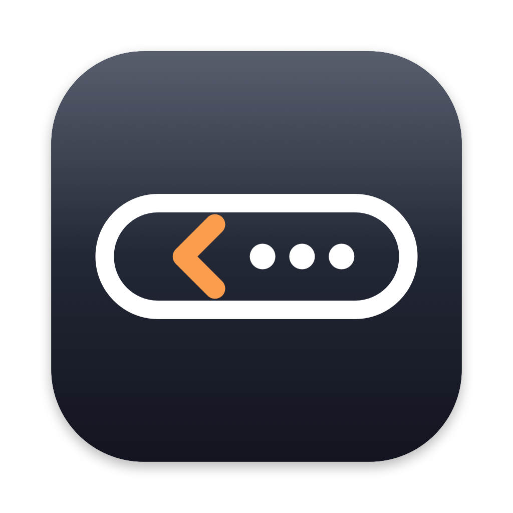
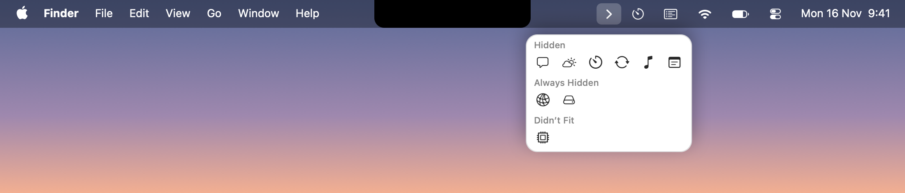
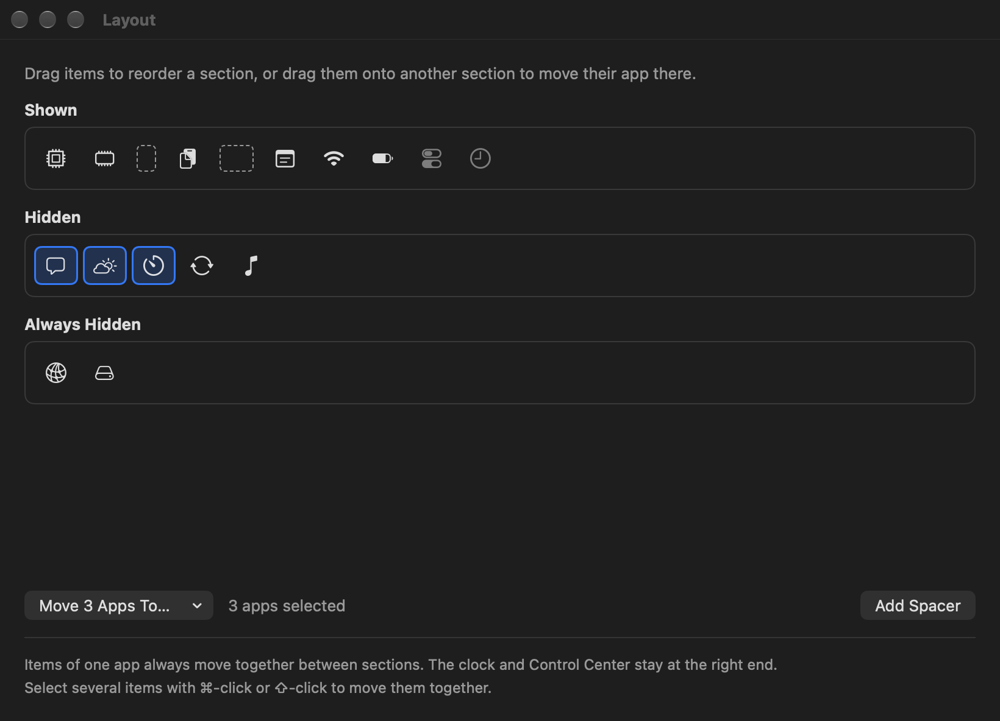

<p align="center">
  
</p>

<h1 align="center">SnugBar</h1>

<p align="center">A menu bar manager for macOS 27, with search, a command line and an MCP server.</p>

<p align="center">
  
</p>

SnugBar hides the menu bar items you don't need and keeps the rest tidy. Hidden items open in a small panel under
the menu bar, where clicking one opens its real menu, and items that don't fit beside the notch go there too instead
of disappearing behind the system's overflow button. You can search every item by name, arrange them in a layout
editor, and drive all of it from the `snugbar` command-line tool, AI agents (MCP) or `snugbar://` links.

SnugBar is free and open source (MIT).

## Install

Download `SnugBar-<version>.dmg` from [Releases](https://github.com/0sahil/snugbar/releases/latest), open it and drag
SnugBar to Applications. Then open SnugBar from Applications; a short setup explains the permissions it asks for.

Homebrew (coming soon, once the tap is published):

```sh
brew install --cask 0sahil/tap/snugbar
```

SnugBar must run from /Applications: macOS hides its icon along with other apps when it runs from elsewhere.

### Requirements

- macOS 27 or later. Earlier versions use a different menu bar engine and aren't supported.
- A Mac with Apple silicon (macOS 27 runs only on Apple silicon).

## Features

### Sections
Every app with menu bar items is in one of three sections: **Shown**, **Hidden** (shown on demand) and **Always
Hidden**. macOS 27 hides whole apps, so all items of one app share a section. Apple's own items, such as the clock and
Control Center, always stay. New apps go to Hidden unless you choose another section in Settings > Sections.

### Showing hidden items
Click SnugBar's icon (right-click or ⌃/⌥-click for its menu). Each of these is optional: a global shortcut, clicking an
empty part of the menu bar, resting the pointer on it, or scrolling on it. Items hide again after a delay, when you
click elsewhere, or when you switch apps, and stay while one of their menus is open.

### SnugBar Bar
By default hidden items open in the SnugBar Bar, a panel under the menu bar with a picture of each item; click one to
open its menu. When the menu bar has no room beside the notch, the leftmost shown apps move there under "Didn't Fit"
(this can be turned off).
With Menu Bar folder access, tiles can be dragged to reorder a group or onto the other group to move the app. Settings
> General can show hidden items in the menu bar itself instead.

### Search and open by letter
A shortcut opens a search palette for every menu bar item, hidden or not; Return opens the item's menu. Recently used
items come first. "Open by letter" gives each item in the SnugBar Bar a key to press.

### Zen mode
One shortcut hides every app's items except Apple's and SnugBar's, and locks every way of showing them, until you turn
it off.

### Layout editor and spacers
**Edit Layout…** shows Shown, Hidden and Always Hidden in menu bar order, with each item's picture (or its app's icon;
rest the pointer on a tile for its name).



- Drag within a row to reorder it, or onto another row to move the app there. Click selects, ⌘-click adds or
  removes, ⇧-click selects a range, ⌘A selects everything, Esc clears; dragging a selected tile moves the whole
  selection. Right-click offers "Move To" and, for spacers, "Remove Spacer". The clock and Control Center can't move.
- With Menu Bar folder access, items move without the pointer moving. Without it, reordering Shown uses a quick ⌘-drag
  of the pointer, and Hidden and Always Hidden can't be reordered (their items aren't on screen to drag).
- **Spacers** are empty gaps (1–64 pt, default 16) that you drag like items. They live in Shown only and aren't listed
  in the SnugBar Bar, search or `snugbar list`. Zen mode shrinks them to nothing until it ends.
- ⌘-dragging items in the menu bar itself still works, and SnugBar keeps the new order.

### Your layout stays put
After SnugBar starts, when an app relaunches, after sleep, when displays change and after a macOS update, SnugBar puts
items back where you arranged them. These checks only write the order file; they never move the pointer.

Before every change to the item order, and before a reset, restore, import or post-update check, SnugBar saves a
backup (the system positions plus its own sections, order and spacers) and keeps the last 20. Settings > Layout lists
them with **Restore**, and has **Reset Layout…**.

### Settings
All settings are one JSON file, `~/Library/Application Support/SnugBar/settings.json`. Settings > General can export
and import it (a file from a newer SnugBar is refused, and the layout is backed up before an import). The access token
and Menu Bar folder access are never part of the file. Settings > General also has the menu bar icon style (Chevrons
or Capsule).

## Permissions

The first time SnugBar starts, a setup window explains each permission, shows whether it's allowed, and opens the
right place in System Settings. Every page can be skipped; open the setup again from SnugBar's menu (Set Up SnugBar…)
or Settings > Permissions. A newly allowed permission takes effect without restarting, except Screen Recording, which
macOS often applies only after a restart (SnugBar offers a Restart button).

| Permission | Used for | Without it |
|---|---|---|
| Accessibility (required) | Reading the menu bar and opening items | Reduced mode: only basic hide and show (the icon, shortcuts, and `expand`, `collapse`, `toggle`, `swap`, `zen`, `move`) |
| Screen Recording (optional) | Pictures of items in the SnugBar Bar and the layout editor | App icons instead; everything else works |
| Menu Bar folder (optional) | Reordering items without moving the pointer (chosen once in an open panel) | Reordering moves the pointer briefly |

In reduced mode SnugBar's icon shows a warning and its menu starts with "Accessibility Needed…". The SnugBar Bar,
search, open by letter, the layout editor, the menu bar gestures, and opening Notification Center from the clock while
items are hidden are unavailable; hidden items show in the menu bar instead. `click` and `order` answer `unavailable`,
`list` and `search` list the apps SnugBar already knows without live positions, and `status` adds `reducedMode`.
SnugBar checks Accessibility every few seconds, so allowing or removing it takes effect on its own.

## Command line, AI agents and links

SnugBar runs one small HTTP server on 127.0.0.1 (port 47811 by default; change the port or turn it off in Settings >
Control). The `snugbar` tool and MCP clients both use it; `snugbar://` links don't. All three take the same commands:

| Command | What it does |
|---|---|
| `list [--section shown\|hidden\|alwaysHidden]` | Items with their section and whether they are on screen |
| `search <query>` | Fuzzy search by app and item name, best match first |
| `show <item>` / `hide <item>` | Show one app's items for a while / hide them again now |
| `click <item>` | Open an item's menu (shows it first if it is hidden) |
| `move <item>... <section>` | Move one or more apps to a section; all items of an app move together |
| `order <item> --before <item>` (or `--after`) | Reorder a shown item; SnugBar keeps the new order |
| `expand`, `collapse`, `toggle`, `swap` | Show or hide the Hidden section, or swap Shown and Hidden |
| `zen [on\|off\|toggle]` | Zen mode |
| `status` | Hiding and arranging methods, permissions, version, port, token |

`<item>` is an item ID from `snugbar list`, an app's bundle ID, or part of an app or item name; when a name matches
several items, the error lists them. `move` looks every item up first, and if one isn't found or is ambiguous, nothing
moves.

### Command-line tool

The tool is inside the app at `SnugBar.app/Contents/Helpers/snugbar` (the Homebrew cask links it for you). Settings >
Control > Install Command-Line Tool… shows the commands to link it into your PATH, for example:

```sh
mkdir -p ~/.local/bin && ln -sf /Applications/SnugBar.app/Contents/Helpers/snugbar ~/.local/bin/snugbar
```

```sh
snugbar list --section hidden
snugbar move "Some App" alwaysHidden
snugbar move chat weather hidden      # several apps; the last word is the section
snugbar click com.example.app
snugbar zen on
snugbar --help                        # snugbar <command> --help for one command
snugbar --version
```

Output is plain text; `--json` prints the server's JSON. `--port N` (or `SNUGBAR_PORT`) picks another port, otherwise
the tool reads it from SnugBar's settings. Exit status: 0 success, 1 the command failed, 2 usage error, 3 SnugBar not
reachable.

### AI agents (MCP)

The endpoint is `http://127.0.0.1:47811/mcp` (Streamable HTTP, JSON responses); each command is a tool named
`snugbar_<command>`. Settings > Control shows these lines with your port and token, with Copy buttons.

```sh
claude mcp add --transport http snugbar http://127.0.0.1:47811/mcp
```

```yaml
# Hermes (config.yaml)
mcp_servers:
  snugbar:
    url: http://127.0.0.1:47811/mcp
```

### Access token

Off by default. With "Require an access token" on (Settings > Control), SnugBar creates a random token in
`~/Library/Application Support/SnugBar/token` (readable only by you) and every request must send
`Authorization: Bearer <token>`. The `snugbar` tool reads the file itself; agents add the header, for example
`claude mcp add … --header "Authorization: Bearer <token>"`, or `headers: { Authorization: Bearer <token> }` in Hermes.
Turning the token off stops checking it but keeps the file; "Regenerate" replaces it.

### HTTP API

`POST /v1/<command>` with a JSON body of string arguments (`item`, `section`, `before`, `after`, `query`, `state`, and
for `move` an `items` array); `GET /v1/status` works too. Every answer is a JSON object with `ok`, and on failure
`error: {code, message, candidates?}` with codes such as `not_found`, `ambiguous`, `invalid_argument`, `unavailable`,
`locked` (Zen mode is on) and `unauthorized`.

```sh
curl -s -X POST http://127.0.0.1:47811/v1/move -d '{"item": "com.example.app", "section": "hidden"}'
```

The server only answers requests whose `Host` is `127.0.0.1:<port>` or `localhost:<port>`, and refuses requests from
web pages (an `Origin` that isn't a loopback address).

### Links

```text
snugbar://expand
snugbar://zen?state=on
snugbar://click?item=com.example.app
snugbar://move?items=com.example.app,com.example.other&section=hidden
snugbar://order?item=com.example.app&before=com.example.other
```

Links take the same arguments as query parameters (`move` also accepts `item` several times). `list`, `search` and
`status` links just run. The first time another app opens a link that changes something, SnugBar asks whether to allow
that app and remembers the answer; when it can't tell which app sent the link, it asks every time. Settings > Control >
Links > Reset forgets the answers.

## Updating

SnugBar updates itself with [Sparkle](https://sparkle-project.org). Once a day it asks GitHub whether a new release is
out; when one is, it offers to install it and relaunch (if you're busy, it waits quietly as "Update Available" at the
top of SnugBar's menu). "Check for Updates…" is in SnugBar's menu. To turn automatic checks off, switch off **Check for
updates automatically** in Settings > General. Updates are signed, and SnugBar checks the signature before installing.

## Privacy

- No telemetry: SnugBar collects no usage data.
- The only network request SnugBar makes is the optional update check to GitHub, which you can turn off in Settings >
  General.
- The control server listens on 127.0.0.1 only, so other machines can't reach it.
- Item pictures are captured from the menu bar only, kept on this Mac (`~/Library/Caches/app.snugbar.SnugBar`), and
  never leave it. Settings are one JSON file in `~/Library/Application Support/SnugBar`.

## Uninstall

Quit SnugBar (its menu > Quit SnugBar; the menu bar is whole again at once) and move it to the Trash. To remove its
data too, delete `~/Library/Application Support/SnugBar`, `~/Library/Caches/app.snugbar.SnugBar` and
`~/Library/Preferences/app.snugbar.SnugBar.plist`. With Homebrew: `brew uninstall --zap snugbar`.

## Build from source

Requirements: macOS 27 and Xcode 27 or later.

```sh
swift build            # debug build
swift test             # unit tests
scripts/build-app.sh   # release build, assembled and signed as build/SnugBar.app
```

`scripts/build-app.sh` signs ad-hoc unless `SIGN_IDENTITY` is set; `--install` also copies the app to /Applications.
Packaging, notarization and releases are described in [docs/RELEASING.md](docs/RELEASING.md); contributions in
[CONTRIBUTING.md](CONTRIBUTING.md).

### Debug commands

The app can run one command without its menu bar icon and write the result as JSON (use absolute paths for `--out`):

```sh
open -W -n build/SnugBar.app --args --debug status --out /tmp/snugbar-status.json
```

- Engine: `status`, `list`, `order-file`, `capture <dir>`, `hide <seconds> [bundle ids to keep]`, `click <item>`,
  `move <item> --before|--after <item>`, `input key|click|move|scroll …`. `hide`, `click`, `move` and `input` change the
  live menu bar or send real input.
- Read-only: `fit-plan`, `search <query>`, `letters [--all]`, `bar-items [--all]`, `reconcile --dry-run`, `backups`,
  `availability --grants <…>`, `permissions`.
- Offscreen renders, with made-up items or permissions (`--grants none` or a comma list of `accessibility`,
  `screenRecording`, `orderFile`): `settings-snapshot --pane <name>`, `layout-snapshot --fake`, `bar-snapshot --fake`,
  `setup-snapshot --step <step>`, `menu-snapshot` (as text) and `menubar-icons` (every icon style and state on light
  and dark menu bars).
- `serve --fake --port <N>` runs the real HTTP/MCP server with made-up items and in-memory state, next to an installed
  SnugBar.

No debug command starts the updater, and the offscreen renders never ask for a permission.

## About

SnugBar is an independent open-source project, created and maintained by 0sahil. It is not affiliated with Apple.

## License

MIT. See [LICENSE](LICENSE).
